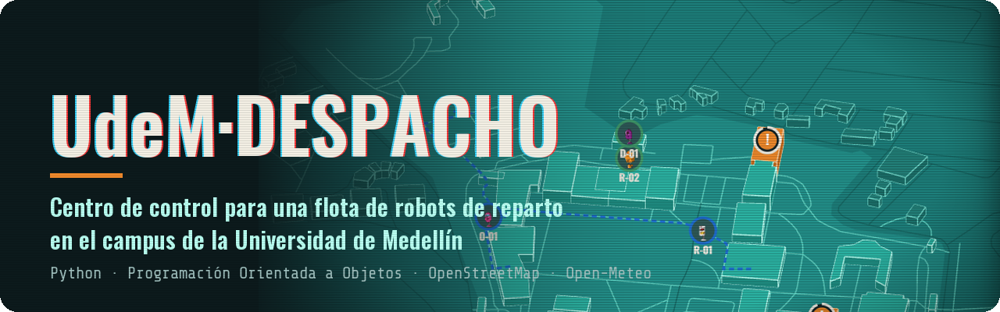
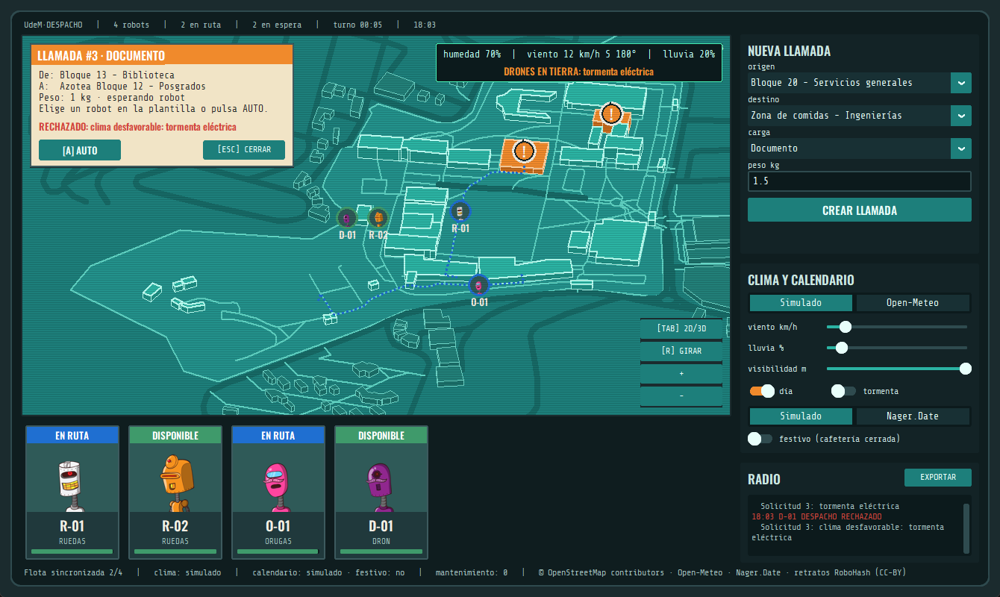
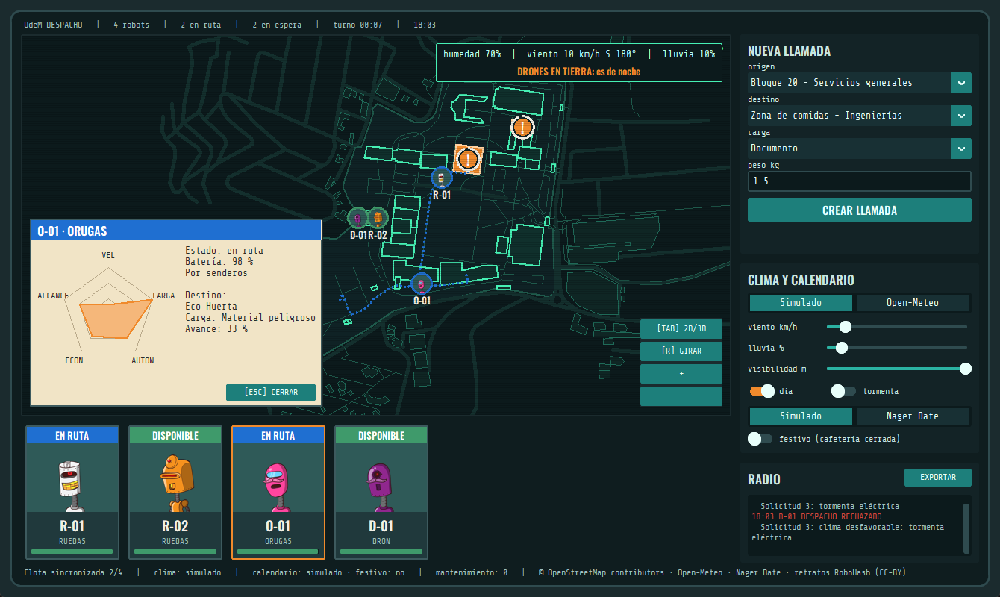
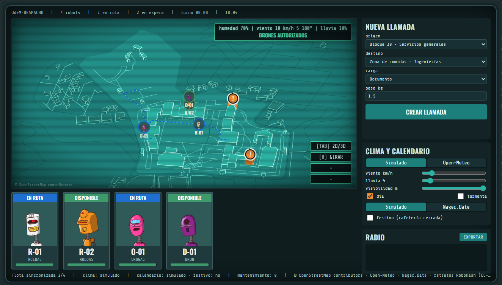
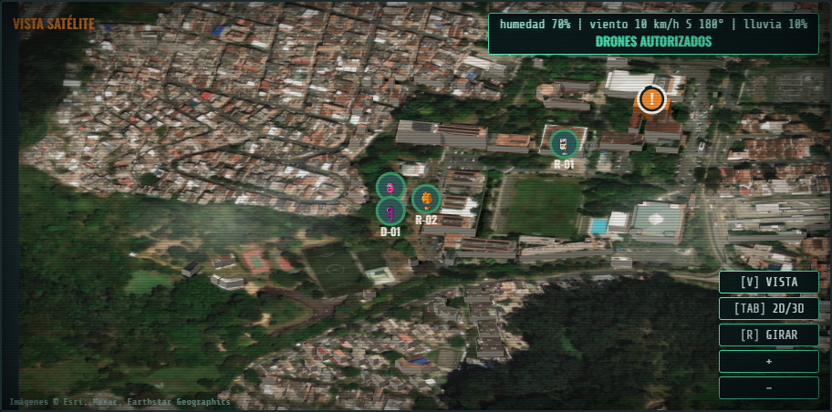
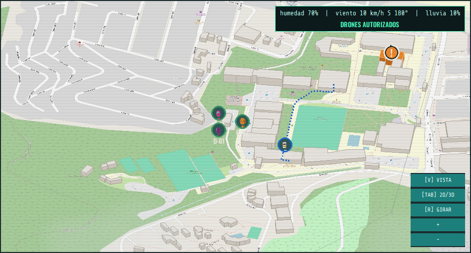
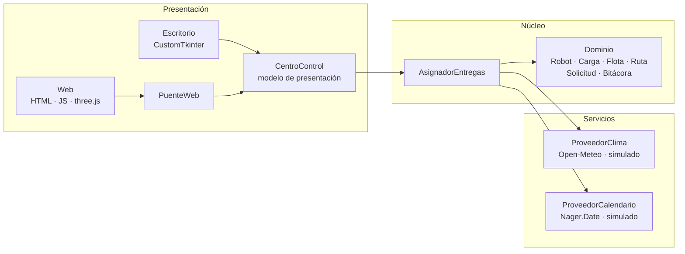

<p align="center">
  
</p>

<p align="center">
  
  
  
  <a href="LICENSE.md"></a>
</p>

<p align="center">
  <a href="#capturas">Capturas</a> ·
  <a href="#características">Características</a> ·
  <a href="#instalación">Instalación</a> ·
  <a href="#uso">Uso</a> ·
  <a href="#arquitectura">Arquitectura</a> ·
  <a href="#documentación-del-curso">Documentación</a> ·
  <a href="#créditos">Créditos</a>
</p>

---

**UdeM·DESPACHO** es el proyecto final de Programación Orientada a Objetos: un sistema que gestiona una
flota mixta de robots de reparto (de ruedas, de orugas y drones) dentro del campus de la Universidad de
Medellín. Registra la flota, recibe solicitudes de entrega y las asigna a un robot compatible. También
calcula el costo y el tiempo por los senderos reales del campus, consulta el clima antes de autorizar un dron
y lleva una bitácora de todo lo que pasa.

El operador trabaja desde un centro de control con el campus en 2D o 3D. Ve las llamadas como balizas
sobre los edificios y despacha cada entrega a mano o en automático. Si elige un robot que no puede, el
sistema le dice exactamente qué regla lo impide.

## Capturas

<p align="center">
  
  <br><sub><b>Escritorio (CustomTkinter), vista 3D.</b> El dron se rechaza por tormenta eléctrica: la ficha y la radio dicen por qué.</sub>
</p>

<p align="center">
  
  <br><sub><b>Vista 2D de noche.</b> Ficha del robot de orugas con su radar: velocidad, carga, autonomía, economía y alcance.</sub>
</p>

<p align="center">
  
  <br><sub><b>Versión web (pywebview + three.js).</b> El mismo sistema, con una cámara 3D que se puede rotar.</sub>
</p>

<table>
  <tr>
    <td width="50%"></td>
    <td width="50%"></td>
  </tr>
  <tr>
    <td align="center"><sub><b>Vista SATÉLITE en 3D</b> (web): la foto aérea en el suelo y en cada techo.</sub></td>
    <td align="center"><sub><b>Vista CALLES en 3D</b> (escritorio): el mapa de calles con los bloques extruidos.</sub></td>
  </tr>
</table>

## Características

**Modelo orientado a objetos**
- Jerarquías con polimorfismo real: `Robot` → `RobotRuedas`, `RobotOrugas`, `Dron`; `Carga` → `Documento`, `Alimento`, `Fragil`, `MaterialPeligroso`.
- Composición `Robot ◆— Bateria`, agregación `Flota ◇— Robot` y encapsulamiento con validaciones en cada clase.
- Los servicios externos (clima y festivos) están detrás de interfaces propias y se inyectan al asignador: el proveedor real se cambia por un simulador en vivo, sin tocar la lógica de asignación.

**Reglas de negocio**
- Asignación automática al robot compatible más barato, o despacho manual con el motivo exacto si no se puede (zona, peso, carga, batería, clima o festivo).
- Los robots terrestres siguen los senderos reales del campus (Dijkstra sobre datos de OpenStreetMap); el dron vuela en línea recta.
- El dron no vuela de noche, con viento o ráfagas fuertes, lluvia probable, tormenta eléctrica o niebla.
- En festivos la cafetería cierra y no se aceptan entregas de alimentos.
- Pendientes que se reintentan solos, mantenimiento por batería y bitácora exportable.

**Interfaz**
- El campus real (95 edificios y 300 caminos de OpenStreetMap) dibujado en 2D o 3D, sin tiles y sin internet.
- Tres vistas: DESPACHO (la del estilo de la consola), CALLES (mapa de OpenStreetMap) y SATÉLITE (foto aérea),
  todas en 2D o 3D. En 3D satelital cada techo muestra su pedazo de la foto real.
- Balizas sobre los edificios, rutas animadas, plantilla de robots con su estado y el nombre de cada bloque al pasar el mouse.
- El clima se ve en el mapa: nubes que avanzan con el viento, lluvia, niebla, relámpagos y luces encendidas de noche.
- Dos interfaces sobre el mismo modelo de presentación: escritorio (CustomTkinter) y web (pywebview + three.js).

**APIs gratuitas, sin API key**

| API | Para qué | Si no responde |
| --- | --- | --- |
| [Open-Meteo](https://open-meteo.com) | viento, ráfagas, lluvia, visibilidad, tormenta, día o noche | el dron no vuela |
| [Nager.Date](https://date.nager.at) | festivos de Colombia | se asume día hábil |
| [Overpass (OpenStreetMap)](https://overpass-api.de) | edificios y senderos del campus (se descarga una vez) | se usan los datos guardados |
| [RoboHash](https://robohash.org) | retrato de cada robot | ícono dibujado según el tipo |
| [Tiles de OpenStreetMap](https://www.openstreetmap.org) | vista CALLES (se descarga una vez y queda en caché) | se queda en la vista DESPACHO |
| [Esri World Imagery](https://www.arcgis.com/home/item.html?id=10df2279f9684e4a9f6a7f08febac2a9) | vista SATÉLITE (se descarga una vez y queda en caché) | se queda en la vista DESPACHO |

## Versiones

| Versión | Dónde | Qué tiene |
| --- | --- | --- |
| Entregada (Fase 5) | rama `main`, tag `v1-entrega` | dominio, clima, asignación y la interfaz de CustomTkinter con el mapa de OpenStreetMap |
| UdeM·DESPACHO | rama `udem-despacho` | todo lo anterior, más rutas por senderos, clima extendido, festivos, despacho manual, el campus en 2D/3D y la versión web |

Para tener las dos versiones lado a lado sin cambiar de rama:

```bash
git worktree add ../proyecto-poo-mejorado udem-despacho
```

## Instalación

Requisitos: Python 3.10 o superior. Para la versión web, Windows 10/11 con WebView2 (viene instalado en Windows 11).

```bash
git clone https://github.com/gtorresc/proyecto-poo.git
```

```bash
pip install -r requirements.txt
```

## Uso

```bash
python main.py --gui      # centro de control de escritorio (CustomTkinter)
python main.py --web      # la misma interfaz en versión web (pywebview + three.js)
python main.py            # demo por consola con el campus UdeM y clima simulado
python main.py --real     # la demo consultando el clima real
python -m pytest          # pruebas
```

- `--real` también vale con `--gui` y `--web`: arrancan con Open-Meteo y Nager.Date en vez de los simuladores.
- `python main.py --web --depurar` abre las herramientas de desarrollo del navegador.
- Con los simuladores, todo funciona sin internet. Las vistas CALLES y SATÉLITE necesitan internet la primera
  vez (unos 5 segundos); después quedan guardadas en `~/.cache/flota-udem/`, fuera del repositorio.

| Acción | Cómo |
| --- | --- |
| Crear una llamada | formulario "NUEVA LLAMADA": aparece una baliza sobre el edificio de origen |
| Despachar a mano | clic en la baliza y luego en un robot de la plantilla |
| Despachar en automático | botón AUTO, o tecla `A` con la llamada abierta |
| Ver el nombre de un bloque | pasar el mouse por encima del edificio |
| Ver el radar de un robot | clic en su tarjeta (sin llamada abierta) |
| Vista 2D o 3D, girar | `Tab` y `R`, o los botones del mapa; rueda para el zoom, arrastre para moverse |
| Rotar libremente (web) | botón derecho del mouse |
| Cambiar clima o festivos | panel "CLIMA Y CALENDARIO": simulador o APIs reales, en vivo |
| Cambiar de vista (DESPACHO, CALLES, SATÉLITE) | `V` o el botón VISTA |
| Cerrar fichas | `Esc` |

## Arquitectura



Las interfaces no tienen reglas de negocio: solo leen el estado de `CentroControl` y le pasan las
acciones del operador. Si se borran, el sistema y sus pruebas siguen funcionando.

```
main.py            punto de entrada (consola, --gui, --web)
src/flota/
  dominio/         robots, cargas, batería, ubicaciones, rutas, solicitudes, bitácora
  servicios/       proveedores de clima y de festivos (API real y simulador)
  asignacion/      asignación automática y despacho manual
  gui/             CentroControl e interfaz de escritorio
  web/             interfaz web y PuenteWeb
  recursos/        fuentes, retratos y sus licencias
  campus.json      puntos de entrega y flota inicial
  campus_osm.json  edificios y caminos del campus (OpenStreetMap)
scripts/           descarga de la geometría del campus
tests/             pruebas con pytest
docs/              entregables del curso, UML y capturas
```

## Documentación del curso

| Fase | Entregable |
| --- | --- |
| 1. Análisis del problema | [fase1-analisis.md](docs/fase1-analisis/fase1-analisis.md) · [PDF](docs/fase1-analisis/fase1-analisis.pdf) |
| 2. Clases y responsabilidades (CRC) | [fase2-crc.md](docs/fase2-crc/fase2-crc.md) · [PDF](docs/fase2-crc/fase2-crc.pdf) |
| 3. Diseño UML | [UML v1](docs/fase3-uml/diagrama_clases_v1.png) · [fuente draw.io](docs/fase3-uml/diagrama_clases_v1.drawio) · [changelog y trazabilidad](docs/fase3-uml/CHANGELOG_UML.md) |
| 4. Justificación de decisiones | [fase4-justificacion.md](docs/fase4-justificacion/fase4-justificacion.md) · [PDF](docs/fase4-justificacion/fase4-justificacion.pdf) |
| 5. Implementación | [código](src/flota) · [pruebas](tests) · [cambios de diseño](docs/CAMBIOS_DISENO.md) · [UML v2](docs/fase3-uml/diagrama_clases_v2.png) · [fuente draw.io](docs/fase3-uml/diagrama_clases_v2.drawio) |
| Mejoras UdeM·DESPACHO | [cambios de diseño, sección 7](docs/CAMBIOS_DISENO.md) · [UML v3](docs/fase3-uml/diagrama_clases_v3.png) · [fuente draw.io](docs/fase3-uml/diagrama_clases_v3.drawio) |
| 6. Reflexión crítica | pendiente |

Presentación de la primera entrega: [PDF](<docs/entrega1/Primera entrega — Flota de robots UdeM.pdf>).
Cada diferencia entre el UML y el código, con su motivo, está en [CAMBIOS_DISENO.md](docs/CAMBIOS_DISENO.md).

## Créditos

- Datos del mapa y tiles de la vista CALLES: © OpenStreetMap contributors, [ODbL](https://www.openstreetmap.org/copyright).
- Imágenes de la vista SATÉLITE: © Esri, Maxar, Earthstar Geographics (no se incluyen en el repositorio).
- Clima: [Open-Meteo](https://open-meteo.com). Festivos: [Nager.Date](https://date.nager.at).
- Retratos de los robots: [RoboHash](https://robohash.org), set1 de Zikri Kader (CC-BY).
- Fuentes: Oswald y Share Tech Mono (SIL Open Font License). 3D: [three.js](https://threejs.org) (MIT).
- Detalle de licencias de terceros en [src/flota/recursos/CREDITOS.md](src/flota/recursos/CREDITOS.md).

## Licencia

El código de este proyecto se distribuye bajo la licencia MIT ([LICENSE.md](LICENSE.md)). Los datos, las
fuentes, los retratos y las librerías de terceros conservan sus propias licencias.
